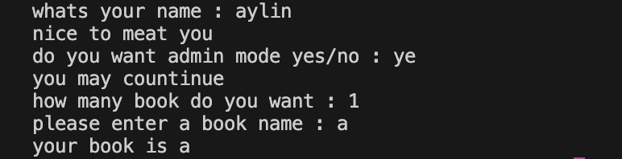
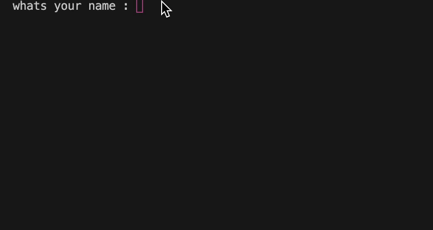

# 🌺 Personal Book Manager🌺
🌺A symple python project that you could enter a book and your name it will save and show to you the next time 🌺

🌺  🌺
## 🌺Features
- 🌺 add multyple book
- 🌺 save book
- 🌺 admin mode
- 🌺 user name
- 🌺 book name

## 🌺Requirments

- 🌺 python
- 🌺 python-dotenv

## 🌺Project Structure

```txt
personal_book_manager/
│   .env.example
│   .gitignore
│   book.py
│   main.py
│   README.md
│   requirements.txt
│
├───photo/
│       screeenshot.png
│____gif
│          gif_1.gif
│______________
```


|_🌺file🌺_|_🌺describtion🌺_|
|---|---|
| 🌺`main.py` | *_`🌺main.py` is the main file it have the main things in it but not the book stuff_*|
|🌺`book.py`|*_`🌺book.py` is the file that have book stuff in it anything that is about book_*|
|🌺`.env.example `| *_🌺it show `admin_pass=yourpassword` and you need to pust the password their_*|
|🌺`requirments.txt` |*_🌺it list the package and the thing that you need for example `python-dotenv`_*|
|🌺`README.MD`|*_🌺`README` it just for telling the user how to use this project and what is it about it show the project instruction and what you need to install and a screenshot and a video of how to use this project_*|
|🌺`.gitignore`|*_🌺the gitignore ignore the file that user shold not see_*|
|🌺`gif folder`|*_🌺the gif folder have the gif file in it for the `README` file_*|
|🌺`gif_1.gif`|*_🌺this file is the gif file that we will use it for the `README`_*|
|🌺`photo file`| *_🌺this folder have the sreenshot for the `README` inside_*|
|🌺`Screenshot.png`|*_🌺The `screenshot` file is for the README_*|


## 🌺Installation

🌺 you need to have install the requirment package 🌺

```
pyton -m pip install -r requirment.txt
```

## 🌺Envirment setup
🌺 create a `.env` file folderfroject folder 🌺

🌺 and `.env.example` use it as a a template 🌺

🌺 add your admin password 🌺 

```env
admin_pass=your_password

```
🌺 chanege "your_password" with the password that you want 🌺


## 🌺run the program
🌺 run the main file 🌺
```bash
For window

python main.py

For mcos

python the versoion(for example "python3") main.py
```

## 🌺Screen shot



## 🌺Demo

